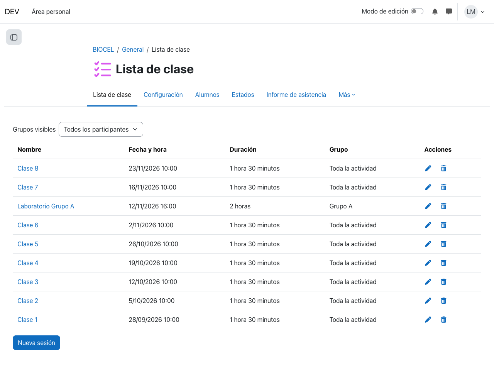
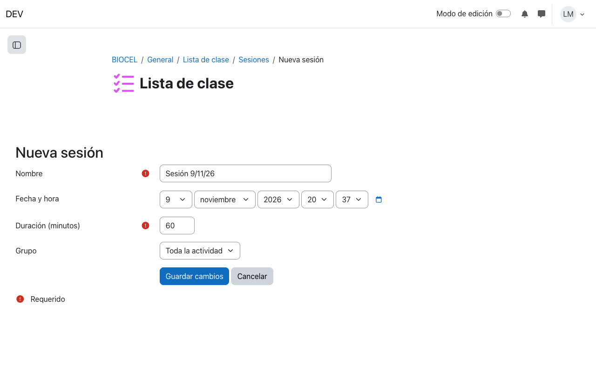
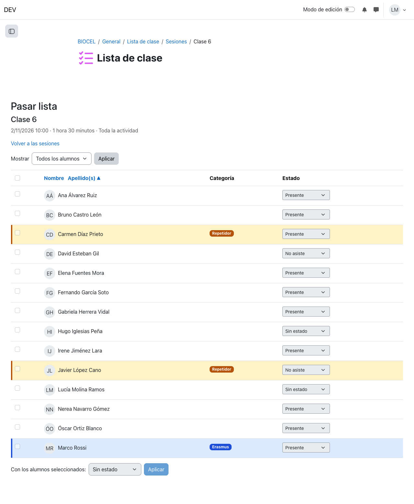
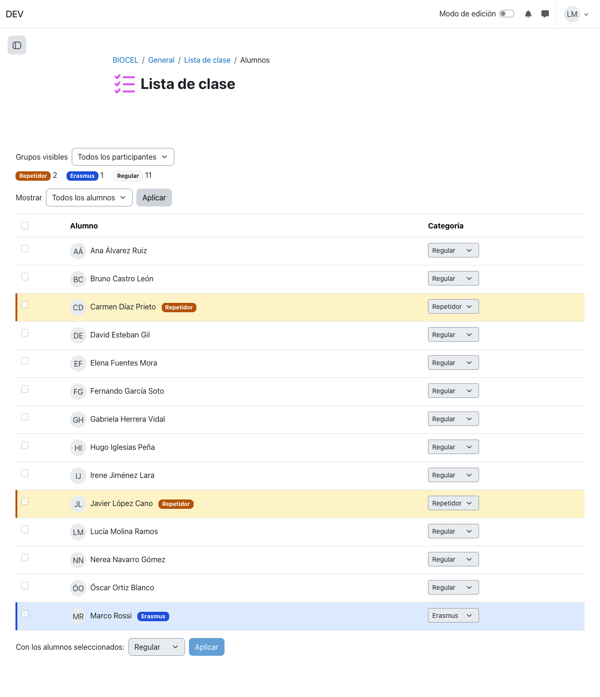
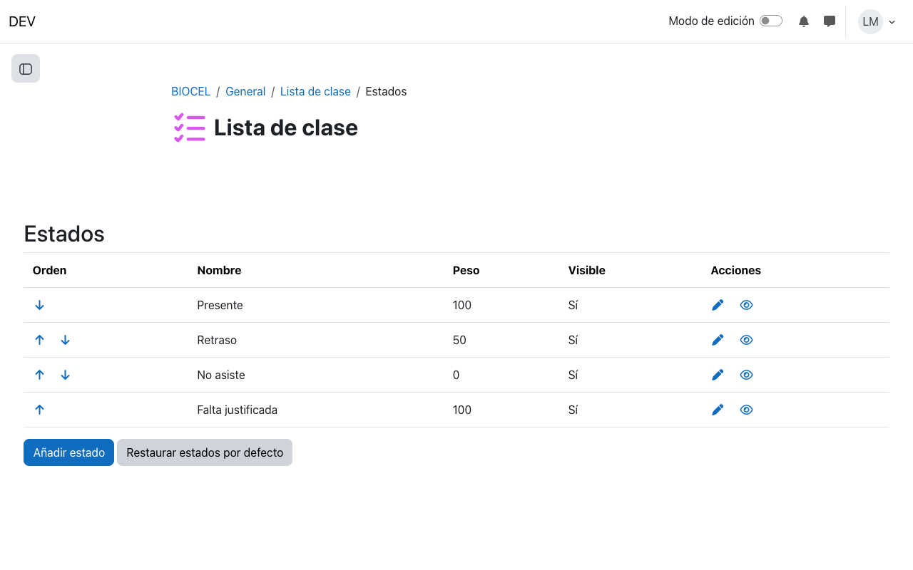
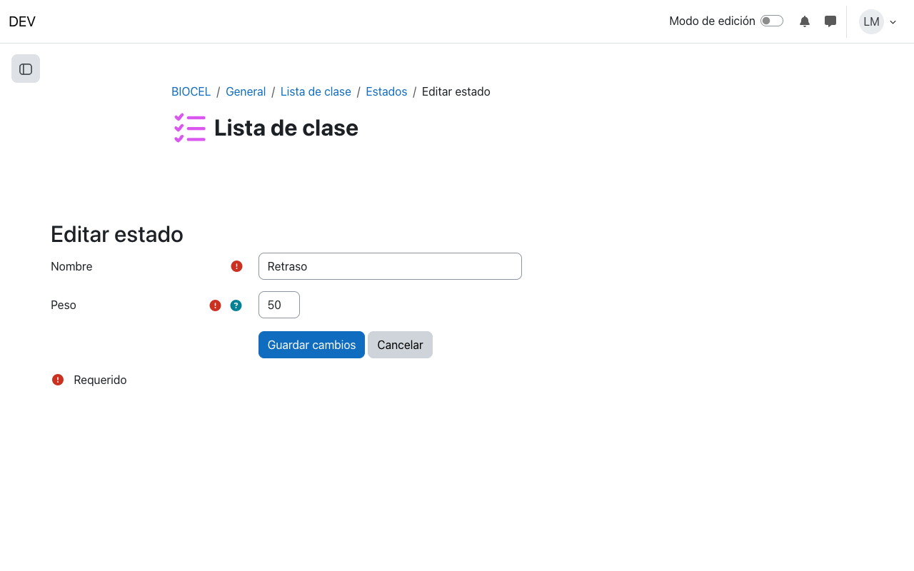
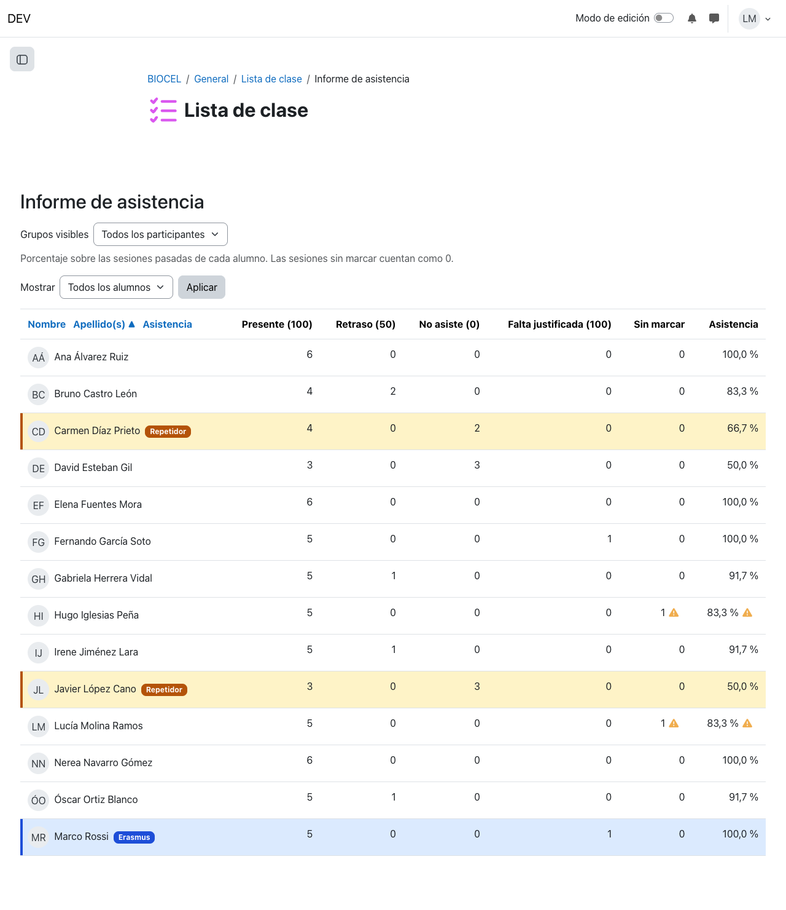

# Lista de clase — Manual para el profesorado

La **Lista de clase** es una actividad de Moodle para pasar lista. Con ella puede:

- ver a los alumnos del curso con un color según su categoría (repetidor, Erasmus…);
- registrar las sesiones (clases) y marcar la asistencia de cada alumno;
- consultar un informe con el porcentaje de asistencia de cada alumno.

Los alumnos no ven la actividad ni sus datos.

## Índice

1. [Añadir la actividad al curso](#1-añadir-la-actividad-al-curso)
2. [Sesiones](#2-sesiones)
3. [Pasar lista](#3-pasar-lista)
4. [Alumnos y categorías](#4-alumnos-y-categorías)
5. [Estados de asistencia y pesos](#5-estados-de-asistencia-y-pesos)
6. [Informe de asistencia](#6-informe-de-asistencia)
7. [Grupos](#7-grupos)
8. [Qué puede hacer cada rol](#8-qué-puede-hacer-cada-rol)
9. [Copias de seguridad y reinicio del curso](#9-copias-de-seguridad-y-reinicio-del-curso)
10. [Preguntas frecuentes](#10-preguntas-frecuentes)

## 1. Añadir la actividad al curso

1. Active el **Modo de edición** del curso.
2. En la sección que quiera, pulse **Añadir una actividad o un recurso** y elija **Lista de clase**.
3. Escriba un nombre (por ejemplo, «Lista de clase» o «Asistencia») y, si el curso tiene grupos, elija el **Modo de grupo** en *Ajustes comunes del módulo*.
4. Pulse **Guardar cambios y mostrar**.

Al crearla, la actividad trae tres estados de asistencia: **Presente** (100), **Retraso** (50) y **No asiste** (0). Puede cambiarlos después (ver [Estados de asistencia y pesos](#5-estados-de-asistencia-y-pesos)).

Dentro de la actividad verá estas pestañas:

| Pestaña | Para qué sirve |
|---|---|
| **Lista de clase** | La portada: la lista de sesiones. |
| **Alumnos** | Ver y clasificar a los alumnos. |
| **Estados** | Configurar los estados de asistencia y sus pesos. |
| **Informe de asistencia** | Ver el porcentaje de asistencia de cada alumno. |

## 2. Sesiones

Una **sesión** es una clase concreta: tiene nombre, fecha y hora, duración y grupo. La portada de la actividad muestra todas las sesiones, de la más reciente a la más antigua.



### Crear una sesión

1. Pulse **Nueva sesión**, al final de la lista.
2. Rellene el formulario:
   - **Nombre**: se propone «Sesión» con la fecha de hoy; puede cambiarlo (por ejemplo, «Clase 7» o «Laboratorio»).
   - **Fecha y hora**: cuándo empieza la clase. Se propone la hora actual.
   - **Duración (minutos)**: de 1 a 1440. Se propone 60.
   - **Grupo**: «Toda la actividad» o un grupo concreto (solo aparece si la actividad usa grupos).
3. Pulse **Guardar cambios**.



> **Consejo:** puede crear las sesiones del cuatrimestre por adelantado. Las sesiones futuras no cuentan en el informe hasta que llega su fecha.

### Editar o borrar una sesión

En la columna **Acciones**:

- el lápiz abre el mismo formulario para cambiar la sesión;
- la papelera la borra.

Si la sesión ya tiene asistencia registrada, Moodle le avisa de cuántos alumnos la tienen antes de borrarla. Al confirmar, esa asistencia se borra también.

## 3. Pasar lista

Pulse el **nombre de la sesión** en la portada. Se abre la lista de alumnos de esa sesión, con un desplegable de estado en cada fila.



- **Cada cambio se guarda al momento**: no hay botón de guardar. Basta con elegir el estado en el desplegable.
- **Sin estado** significa que el alumno todavía no está marcado en esa sesión.
- **Marcar a varios a la vez:** marque las casillas de los alumnos (la casilla de la cabecera selecciona a todos los de la página). Después, abajo, en **Con los alumnos seleccionados**, elija un estado y pulse **Aplicar**.

  Por ejemplo, para pasar lista rápido: seleccione a todos, aplique **Presente** y cambie después solo a los que faltan.
- **Mostrar**: filtra por categoría (por ejemplo, solo los repetidores).
- **Nombre / Apellido(s)**: ordena la lista. Pulse otra vez para invertir el orden.
- Si hay muchos alumnos, la lista se reparte en páginas. El número de alumnos por página lo fija la administración del sitio.

Si la sesión es de un grupo, la lista muestra solo a los alumnos de ese grupo.

Para volver a la portada, pulse **Volver a las sesiones**.

## 4. Alumnos y categorías

La pestaña **Alumnos** muestra a todos los alumnos del curso. Cada alumno clasificado tiene su fila en un color y una etiqueta con su categoría. Arriba hay una leyenda con cuántos alumnos hay en cada categoría.



Para **clasificar** a un alumno, elija su categoría en el desplegable de la columna **Categoría**. Se guarda al momento.

Para clasificar a **varios a la vez**, márquelos con la casilla, elija la categoría en **Con los alumnos seleccionados** y pulse **Aplicar**. **Regular** quita la categoría.

Tenga en cuenta:

- **La clasificación es del curso**, no de la actividad. Si el curso tiene varias Listas de clase, todas comparten la misma clasificación.
- **Las categorías las define la administración del sitio**, no el profesorado. Si necesita una categoría nueva, pídasela.
- Solo el **profesor con permiso de edición** puede clasificar. El profesor sin permiso de edición ve los colores, pero no puede cambiarlos.

## 5. Estados de asistencia y pesos

Cada Lista de clase tiene sus propios **estados** (Presente, Retraso…). Cada estado tiene un **peso**: un número de 0 a 100 que indica cuánto vale una sesión con ese estado si la sesión completa vale 100.

| Estado | Peso por defecto | Significado |
|---|---|---|
| Presente | 100 | la sesión cuenta entera |
| Retraso | 50 | cuenta la mitad |
| No asiste | 0 | no cuenta |

El peso es lo que usa el [Informe de asistencia](#6-informe-de-asistencia) para calcular el porcentaje.



En la pestaña **Estados** puede:

- **Añadir estado**: por ejemplo, «Falta justificada» con peso 100, si las faltas justificadas no deben penalizar.
- **Editar** (lápiz): cambiar el nombre o el peso.
- **Ordenar** (flechas): el orden es el de los desplegables al pasar lista y el de las columnas del informe.
- **Ocultar o mostrar** (ojo): un estado oculto ya no aparece al pasar lista, pero la asistencia ya registrada con él se conserva y sigue contando en el informe.
- **Borrar** (papelera): solo se pueden borrar los estados que no se han usado nunca. Los demás solo se pueden ocultar.
- **Restaurar estados por defecto**: vuelve a crear Presente, Retraso y No asiste si alguno falta. No toca los estados que ya existen.



El peso es obligatorio y tiene que ser un número entero entre 0 y 100.

> **Importante:** el informe se calcula siempre con los pesos actuales. Si cambia el peso de un estado, cambian los porcentajes de todos los alumnos, también los de sesiones pasadas.

Gestionar los estados requiere ser **profesor con permiso de edición**.

## 6. Informe de asistencia

La pestaña **Informe de asistencia** muestra una fila por alumno con:

- cuántas veces ha tenido cada estado (una columna por estado, con su peso entre paréntesis);
- **Sin marcar**: cuántas sesiones pasadas no tienen estado;
- **Asistencia**: su porcentaje de asistencia.



### Cómo se calcula el porcentaje

```
porcentaje = suma de los pesos de sus estados / número de sesiones pasadas
```

- **Solo cuentan las sesiones pasadas**, es decir, las que ya han empezado. Las sesiones futuras no cuentan.
- **Una sesión pasada sin marcar cuenta como 0** y se señala con el aviso ⚠ junto al número de *Sin marcar* y junto al porcentaje. Así sabe que el porcentaje puede subir cuando termine de pasar lista.
- Si todavía no hay sesiones pasadas, el porcentaje se muestra como «—».

Ejemplos con los datos de la captura (6 sesiones pasadas):

| Alumno | Estados | Cálculo | Asistencia |
|---|---|---|---|
| Bruno | 4 Presente, 2 Retraso | (4 × 100 + 2 × 50) / 6 | 83,3 % |
| Carmen | 4 Presente, 2 No asiste | (4 × 100 + 2 × 0) / 6 | 66,7 % |
| Fernando | 5 Presente, 1 Falta justificada | (5 × 100 + 1 × 100) / 6 | 100,0 % |
| Hugo | 5 Presente, 1 sin marcar ⚠ | (5 × 100 + 0) / 6 | 83,3 % |

### Qué sesiones cuentan para cada alumno

A cada alumno le cuentan:

- las sesiones de **toda la actividad**;
- las sesiones de los **grupos a los que pertenece ahora**;
- las sesiones de grupos que se han borrado.

No le cuentan las sesiones de otros grupos. Por eso dos alumnos pueden tener un número distinto de sesiones.

La **fecha de matrícula no se tiene en cuenta**: a un alumno que se matriculó tarde le cuentan como sin marcar las sesiones anteriores a su llegada. Usted decide cómo marcarlas, por ejemplo con un estado «No matriculado» de peso 100.

### Filtrar y ordenar

- **Grupos**: muestra solo a los alumnos de un grupo.
- **Mostrar**: filtra por categoría.
- **Nombre / Apellido(s) / Asistencia**: ordena por nombre, por apellidos o por porcentaje. Pulse otra vez para invertir el orden. Ordenar por *Asistencia* de menor a mayor es una forma rápida de ver quién falta más.

El informe es de solo lectura y no se puede exportar todavía.

## 7. Grupos

Si la actividad usa grupos (modo de grupo *separados* o *visibles*), en la portada, en *Alumnos* y en el informe aparece un selector de grupo.

- Una sesión puede ser de **toda la actividad** o de **un grupo**. Al pasar lista en una sesión de grupo, solo aparecen los alumnos de ese grupo.
- **Sesiones de toda la actividad:** solo las puede crear, editar o borrar quien tiene acceso a todos los grupos. Normalmente es el profesor con permiso de edición.
- **Sesiones de un grupo:** las puede gestionar un profesor de ese grupo.
- **Grupos visibles:** un profesor ve las sesiones de los demás grupos, pero no puede cambiarlas.
- **Grupos borrados:** si se borra un grupo, sus sesiones se conservan y aparecen como «Grupo eliminado». Solo las ve quien tiene acceso a todos los grupos.

## 8. Qué puede hacer cada rol

| Acción | Profesor | Profesor sin permiso de edición |
|---|---|---|
| Añadir la actividad al curso | ✔ | — |
| Ver sesiones y alumnos | ✔ | ✔ |
| Crear, editar y borrar sesiones | ✔ | ✔ (según los grupos) |
| Pasar lista | ✔ | ✔ (según los grupos) |
| Clasificar alumnos | ✔ | — |
| Gestionar estados y pesos | ✔ | — |
| Ver el informe de asistencia | ✔ | ✔ |

Los alumnos no ven nada de la actividad.

## 9. Copias de seguridad y reinicio del curso

- **Copia de seguridad o duplicado de la actividad:**
  - Las **sesiones** y los **estados**, con sus pesos, se copian siempre.
  - La **asistencia** solo se copia si la copia incluye datos de usuario.
  - La **clasificación** de los alumnos nunca se copia.
- **Reinicio del curso** (para empezar un curso nuevo). Hay tres opciones, marcadas por defecto:
  - borrar la clasificación de los alumnos;
  - borrar la asistencia registrada (se conservan las sesiones);
  - borrar todas las sesiones.

  Los estados no se tocan.

## 10. Preguntas frecuentes

**¿Tengo que pulsar «Guardar» al pasar lista?**
No. Cada cambio de estado se guarda en el momento.

**Un alumno tiene ⚠ en el informe. ¿Qué significa?**
Que tiene sesiones pasadas sin marcar, que cuentan como 0. Abra esas sesiones y márquelo.

**He cambiado el peso de «Retraso» y han cambiado todos los porcentajes. ¿Es normal?**
Sí. El informe no guarda porcentajes: los calcula cada vez con los pesos actuales.

**No puedo borrar un estado.**
Ya se ha usado para registrar asistencia. Ocúltelo con el icono del ojo: deja de aparecer al pasar lista y la asistencia ya registrada se conserva.

**No veo la pestaña «Estados» ni puedo clasificar alumnos.**
Esas funciones requieren ser profesor con permiso de edición.

**Necesito una categoría de alumnos nueva.**
Las categorías son comunes a todo el campus y las gestiona la administración del sitio. Pídasela.
